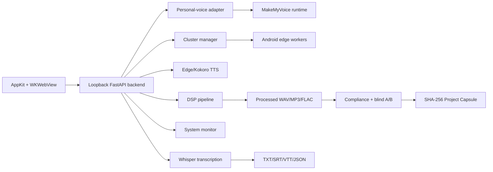

<div align="center">

# AudioEnhancerMAX

### The open-source AI audio media center

**Professional audio enhancement, transcription, TTS, monitoring, and edge processing.**<br>
**16+ processing modules · Apple Silicon acceleration · deterministic local Smart Enhance · reviewable speech editing · local-first core · v3.8.0**

Version 3.8 binds checkpoints, playback, conversions, delivery guidance and project evidence to a specific completed output. It also publishes the REA developer research workflow. [Release notes](releases/RELEASE_NOTES_v3.8.0.md) · [Validation](docs/revision-delivery.md).

[](LICENSE)
[](https://python.org)
[](https://fastapi.tiangolo.com)
[](#)
[](https://sourceforge.net/projects/audioenhancermax/)

[Official Website](https://fabriziodegni.com/AudioEnhancerMAX/) ·
[SourceForge](https://sourceforge.net/projects/audioenhancermax/) ·
[Roadmap](web/roadmap.html) ·
[Documentation](#documentation) ·
[Changelog](CHANGELOG.md) ·
[Contributing](CONTRIBUTING.md)


AudioEnhancerMAX turns raw recordings into cleaner, production-ready audio without requiring a cloud service for the core processing pipeline.

</div>

---

## Why It Exists

AudioEnhancerMAX is built for creators, podcasters, researchers, interviewers, and audio-heavy workflows where privacy, control, and auditability matter. It combines local DSP, AI-assisted decisions, real-time monitoring, transcription, text-to-speech, and optional Android edge workers in one FastAPI + vanilla JS application.

The v3.8.0 source release and direct macOS preview use an app-owned AppKit/WKWebView window. Apple notarization of the new DMG is awaiting the developer team's updated agreement; the notarized 3.7.0 remains the stable Mac download. See [macOS App](docs/macos-app.md).

The default architecture is local-first: uploads, DSP output, timing history, and local model inference stay on the host machine unless you explicitly enable an integration that sends data elsewhere. You decide when to use local AI through Ollama/Gemma, when to offload DSP chunks to trusted devices on your LAN, and which output format to export.

AudioEnhancerMAX has also been recognized with the **SourceForge Rising Star Award** for open-source traction and community engagement.

## Highlights

| Area | What You Get |
| --- | --- |
| Audio cleanup | DeepFilterNet/noisereduce fallback, wind, buzz, static, reverb/echo, breath, mouth-click and silence handling |
| Speech editing | Non-destructive EDL for fillers, repetitions, pauses, breaths and mouth clicks, with original/proposed preview |
| Enhancement | Studio sound chain, Auto EQ, LUFS normalization, super-resolution, Demucs music preservation |
| Audio intelligence | Smart Enhance signal diagnosis, Conservative/Balanced/Maximum processing profiles, deterministic tuning and quality reports |
| Delivery | Five fixed output profiles with WAV/MP3/FLAC overrides recorded in the processing report |
| Delivery review | Local loudness/estimated-true-peak/clipping/sample-rate guidance, randomized blind A/B, and SHA-256 Project Capsules |
| Transcription | Faster-Whisper, streaming SSE delivery, TXT/SRT/VTT/JSON export, crash-resilient partial saves |
| TTS | Local Kokoro, optional Edge Neural, expressive rewrite, and named MakeMyVoice personal-voice profiles |
| Monitoring | Whole-system, SoC, and AudioEnhancer process CPU plus GPU/ANE/RAM/power/thermal data; adaptive ETA only when real progress exists |
| Edge compute | Android Kotlin worker app with HTTP processing and UDP discovery on trusted LANs |

## Quick Start

### macOS App (Apple Silicon)

Download the appropriate artifact from [GitHub releases](https://github.com/sev7enITA/AudioEnhancerMAX/releases) or [SourceForge](https://sourceforge.net/projects/audioenhancermax/files/). The 3.8.0 direct DMG is a signed preview pending Apple notarization; 3.7.0 remains the notarized stable Mac package. Requires Apple Silicon and macOS 13+. Mac App Store approval is a separate stage.

### Run from Source

### Requirements

- Python 3.11+
- FFmpeg
- macOS Apple Silicon recommended, with Linux/Windows support for core local processing
- Ollama + Gemma model optional for editorial suggestions and expressive TTS rewrite
- Android Studio/JDK 17 or 21 optional for building the Android worker

### Install

```bash
git clone https://github.com/sev7enITA/AudioEnhancerMAX.git
cd AudioEnhancerMAX

python3 -m venv venv
source venv/bin/activate
pip install --upgrade pip
pip install -r requirements.txt
```

### Run Locally

```bash
python -m uvicorn app.main:app --host 127.0.0.1 --port 8000 --reload
```

Open [http://127.0.0.1:8000](http://127.0.0.1:8000).

For LAN testing, bind explicitly and restrict browser origins:

```bash
export AEMAX_CORS_ORIGINS="http://192.168.1.20:8000,http://localhost:8000"
python -m uvicorn app.main:app --host 0.0.0.0 --port 8000
```

## Optional AI Setup

```bash
brew install ffmpeg
brew install ollama
ollama pull gemma4:e2b
```

`gemma4:e2b` is the preferred optional model name when available; the app also auto-detects other local Gemma-family models exposed by Ollama. Smart Enhance diagnosis and DSP decisions never require Ollama: they are deterministic, local and available offline. Gemma is limited to explicitly requested editorial prose and expressive TTS rewriting.

## Optional Personal Voices

When running from source, AudioEnhancerMAX looks for MakeMyVoice in the sibling `MakeMyVoice/` project directory. Set `AEMAX_MAKEMYVOICE_ROOT` when it lives elsewhere. The adapter reads the current MakeMyVoice engine, model, version and fine-tuning target dynamically; it does not install or mutate that environment during synthesis.

```bash
export AEMAX_MAKEMYVOICE_ROOT="/absolute/path/to/MakeMyVoice"
```

## Android Edge Worker

The native Android worker lives in [android-worker](android-worker/). It exposes a small HTTP service on port `8877` and advertises itself to the master over UDP on trusted local networks.

```bash
cd android-worker
export JAVA_HOME="/path/to/jdk17-or-jdk21"
./gradlew assembleDebug
```

Prebuilt debug APKs are stored in [releases](releases/).

## Architecture



## Transparency and AI Governance

AudioEnhancerMAX should be evaluated as a **local-first, AI-assisted tool**, not as a black-box autonomous audio editor. Processing choices remain visible in the UI, source audio is preserved, and optional external services are documented.

| Component | Data Flow | Governance Note |
| --- | --- | --- |
| Uploads and processed audio | Stored locally under `app/uploads/` and `app/outputs/` | Original files are not modified by the pipeline. |
| DSP filters | Run locally in Python, or on explicitly trusted LAN workers | Output quality depends on source material and selected settings. |
| Faster-Whisper transcription | Runs locally when dependencies and models are installed | Transcript accuracy must be reviewed for high-stakes use. |
| Audio Intelligence and Smart Enhance | Deterministic local signal analysis | Measured issues, profiles and fallback engines remain visible and auditable. |
| Ollama/Gemma editorial assistance | Optional local Ollama process | Limited to explicitly requested prose and expressive TTS rewriting; it does not control DSP parameters. |
| Precision Speech Editor | Local word timestamps and acoustic candidates | Every edit defaults to Keep, uses revisioned decisions and renders to a new file. |
| Delivery Compliance Lab | Local BS.1770 loudness method plus measured/estimated signal facts | Workflow guidance only; results are not regulatory or third-party certification. |
| Project Capsule | Local ZIP and SHA-256 manifest | Processed output and evidence are included; source audio is opt-in and off by default. |
| Kokoro TTS | Runs locally when installed | Local model availability depends on installed packages and voice assets. |
| Edge Neural TTS | Optional external service | Text is sent to Microsoft Edge TTS when this engine is selected. |
| MakeMyVoice personal voices | Optional local sibling runtime | Named profiles and defaults are owned by AudioEnhancerMAX; reference selection, cloning and approved fine-tuned models are resolved through the current MakeMyVoice runtime. Explicit voice-owner consent is required for enrollment. |
| Android edge workers | Audio chunks are sent over trusted LAN | Use only with devices you control and networks you trust. |
| SourceForge badge | Browser loads SourceForge badge script on public pages | This is presentation metadata, not part of the audio pipeline. |

For governance-sensitive workflows, keep the original audio, record the selected preset/options, review AI-generated transcripts, and document any external engine used for TTS or distribution.

## Security Posture

AudioEnhancerMAX is local-first software. By default, the server is documented for `127.0.0.1`, CORS is restricted to local origins, and user-controlled file IDs, download formats, versions, and preset IDs are validated before touching local storage.

Do not expose the FastAPI server directly to the public internet without adding authentication, rate limiting, storage quotas, and a reverse proxy policy.

## Documentation

- [Signal Console Design Contract](DESIGN.md)
- [Visual Design Reference](docs/design-preview.html)
- [Getting Started](docs/getting-started.md)
- [Feature Guide](docs/features.md)
- [API Reference](docs/api.md)
- [Edge Computing Setup](docs/edge-computing.md)
- [Developer Onboarding](docs/developer-onboarding.md)
- [REA Audio Competitor Research](research/rea/README.md)
- [AI Governance Notes](docs/ai-governance.md)
- [macOS App and Packaging](docs/macos-app.md)
- [v3.7 Release Notes](releases/RELEASE_NOTES_v3.8.0.md)
- [3.7.4 Delivery Review Evidence](docs/delivery-review-evidence.md)
- [v3.6-to-v3.7 Implementation Record](docs/v3.6-implementation-plan.md)
- [Troubleshooting / FAQ](docs/faq.md)
- [Translation Notes](docs/translation.md)

## Development Checks

```bash
source venv/bin/activate
python -m compileall -q app
python -m pytest -q
node --test tests/test_review_state.cjs
pip install -r requirements-dev.txt
ruff check app
bandit -r app
```

## Project Links

- GitHub: [sev7enITA/AudioEnhancerMAX](https://github.com/sev7enITA/AudioEnhancerMAX)
- Official website: [fabriziodegni.com/AudioEnhancerMAX](https://fabriziodegni.com/AudioEnhancerMAX/)
- SourceForge: [sourceforge.net/projects/audioenhancermax](https://sourceforge.net/projects/audioenhancermax/)

## License

AudioEnhancerMAX is released under the [MIT License](LICENSE).

---

<div align="center">

**AudioEnhancerMAX by Fd**<br>
The local-first audio media center for the AI era.

</div>
